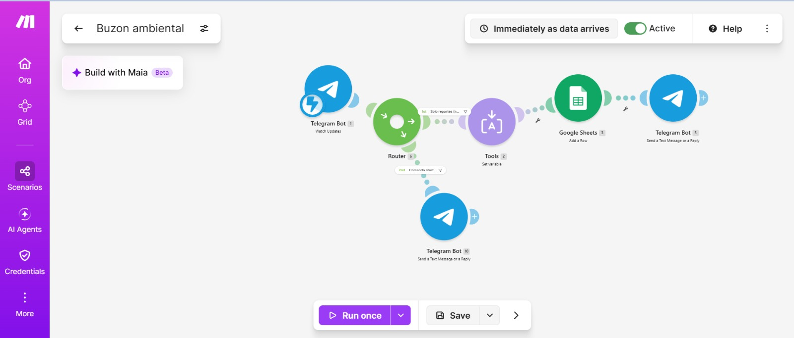
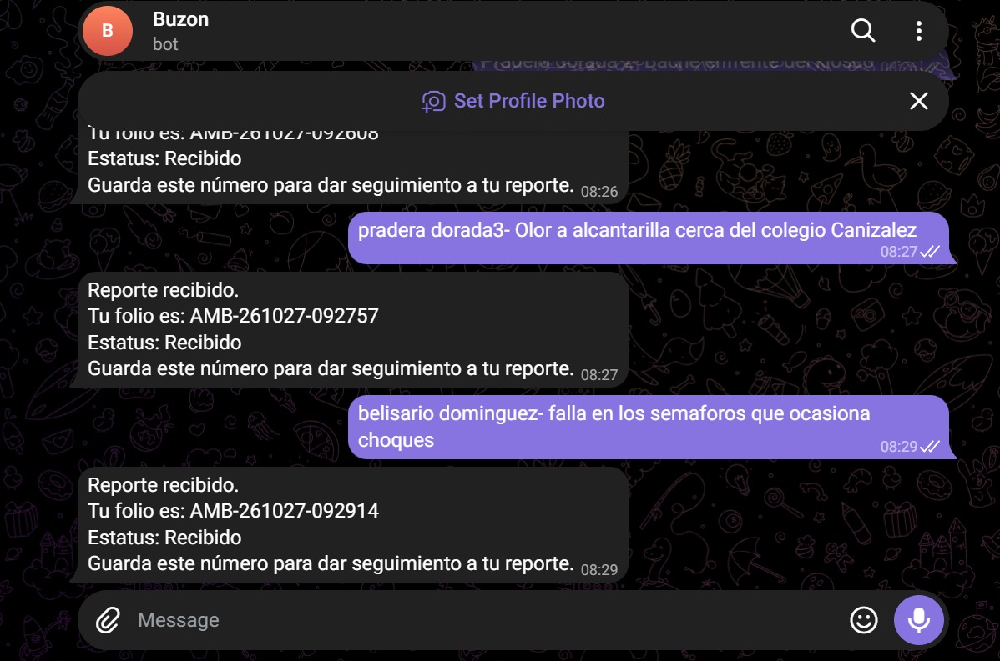
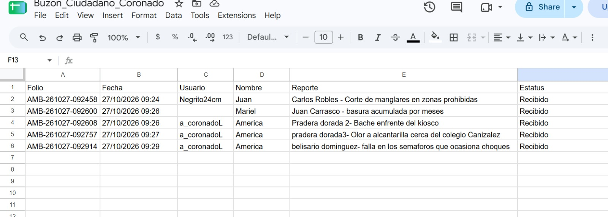
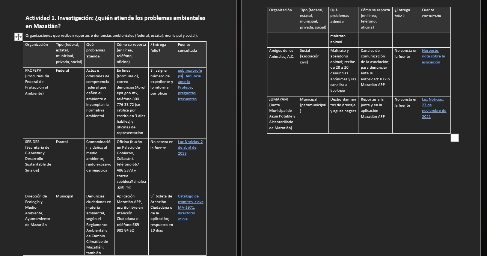

# Nombre del proyecto
Buzón ciudadano con folio
## Descripción
El buzón es un bot de Telegram conectado a un escenario de Make que recibe reportes ambientales escritos por los ciudadanos con el formato “Colonia - Problema”. Cada reporte se guarda en una hoja de Google Sheets junto con un folio único, la fecha, el usuario, el nombre y un estatus inicial de “Recibido”, y el bot responde al ciudadano con su folio para que pueda dar seguimiento. Además, un Router permite que el comando /start devuelva instrucciones de uso en lugar de registrarse como si fuera un reporte.

## Objetivos de aprendizaje
Identificar qué organizaciones de la comunidad atienden los problemas ambientales y construir, sin programar, un buzón ciudadano automatizado que registre reportes con fecha, usuario y folio, para reflexionar sobre el valor de la participación ciudadana formal.

## Material utilizado
Enumera todos los componentes usados:
1. Make
2. Telegram
3. Google sheets
  
## Código
[Buzon ambiental.blueprint.json](<Codigo/Buzon ambiental.blueprint.json>)

## Imagenes
Foto del diagrama Make

Foto Bot Telegram

Foto Google sheets

Foto act. 1

## Resultados
Incluye:
[Resultados](Resultados/Resultado_Buzon_Ciudadano.pdf)

## Video del funcionamiento
[Readme](Video/readme.txt)

[Ver video en YouTube](https://youtu.be/dlbZfRPe83c)

## Conclusiones
La práctica cumple su objetivo: se construyó un buzón ciudadano automatizado que registra reportes ambientales con folio, fecha y usuario, y que responde al ciudadano con un comprobante. Al compararlo con los sistemas oficiales se identificó que su principal limitación es que no cuenta con una autoridad que lo atienda ni con plazos de respuesta, lo que muestra que la tecnología facilita la participación, pero no sustituye la responsabilidad de las instituciones.
