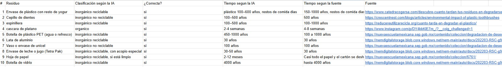
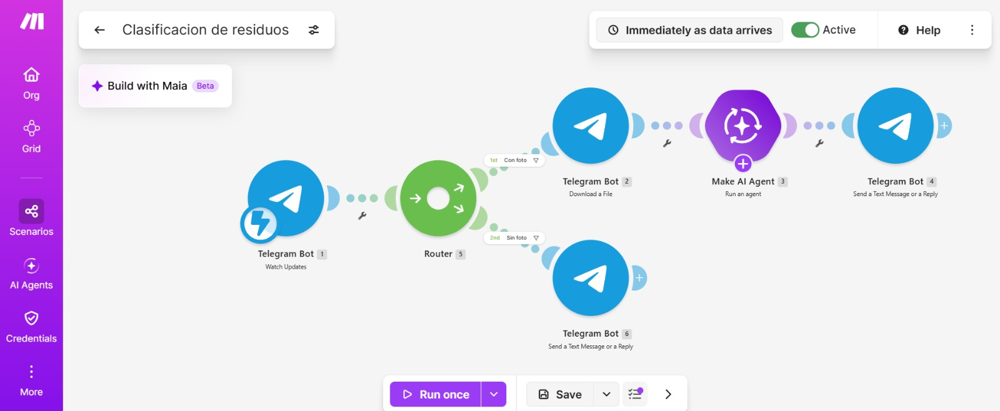
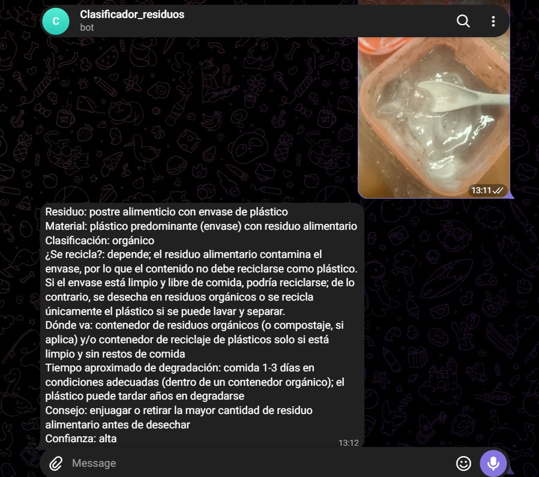

# Nombre del proyecto
Clasificador de residuos por foto
## Descripción

## Objetivos de aprendizaje
Que el alumno identifique el impacto de los residuos que genera en su vida diaria, construya sin programar un clasificador de residuos con IA y evalúe la precisión de la IA comparándola con fuentes oficiales.

## Material utilizado
Enumera todos los componentes usados:
•Celular con Telegram y cámara.
• Cuenta de Make del curso (plan Pro). La IA usa la conexión Make&#39;s AI Provider; no se necesita
API key.
• Computadora con navegador.
• 10 residuos distintos de su casa o del campus para fotografiar (limpios, sin manipular residuos
peligrosos).
• Haber realizado la práctica del chatbot de Gobernanza (BotFather, Watch Updates y
setWebhook).
   
  
## Código
[Clasificacion de residuos.blueprin](<Codigo/Clasificacion de residuos.blueprint.json>)

## Imagenes

Foto de las 10 pruebas en google sheets

Foto make

Foto de la prueba en telegram

[Residuos pdf](Imagenes/Residuos%20en%20M%C3%A9xico%20y%20Mazatl%C3%A1n.pdf)

[Pruebas con 10 residuos](Imagenes/Pruebas%20con%2010%20residuos%20-%20Sheet1.csv)
## Resultados
Incluye:
[Resultados](Resultados/Resultado_Clasificador_de_residuos.pdf)

## Video del funcionamiento
[Readme](Video/readme.txt)

[Ver video en YouTube]()

## Conclusiones
La práctica cumple su objetivo: se construyó un clasificador de residuos por foto con Telegram, Make y un agente de IA con visión, y se evaluó su precisión comparándolo con fuentes oficiales. Se identificó que una parte importante de los residuos de uso diario no se recicla de forma sencilla, que tardan décadas o siglos en degradarse y que en Mazatlán llegan al estero y a las playas en forma de plásticos y microplásticos, mientras la ciudad enfrenta el problema de un basurón sin relleno sanitario definido. También quedó claro que la IA es una ayuda para orientar la separación, pero no sustituye la verificación ni la responsabilidad compartida entre ciudadanos, municipio y empresas.
