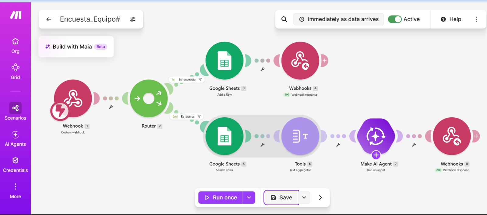
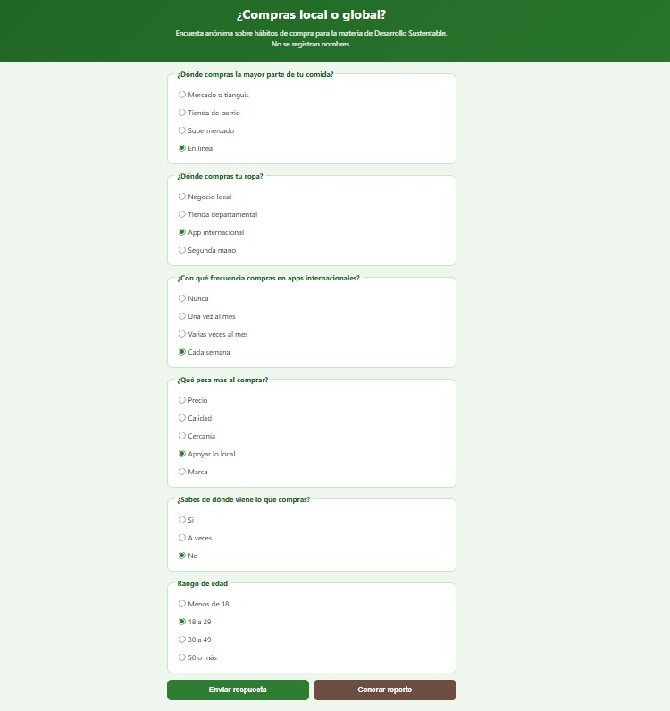
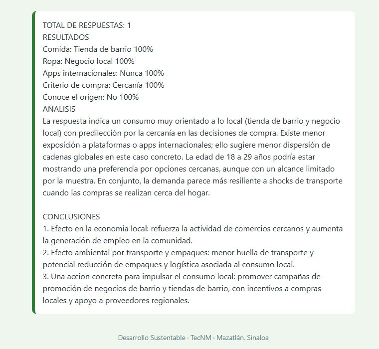
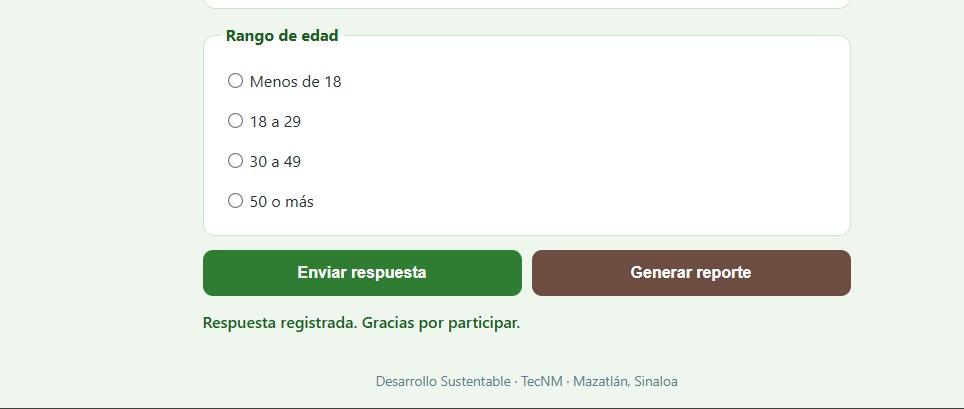
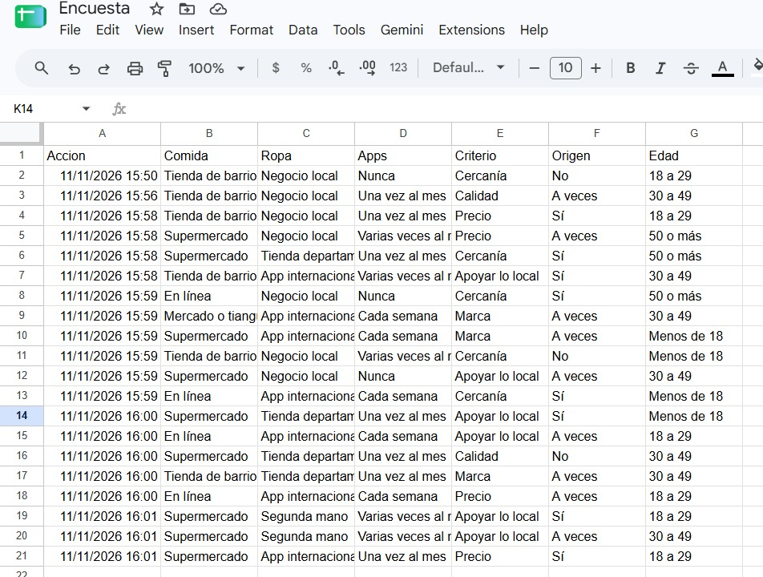

# Nombre del proyecto
Encuesta ¿Compras local o global?

## Descripción
“Encuesta ¿Compras local o global?” es un sistema que convierte las respuestas de una encuesta en un reporte automático. La página web, generada con IA y publicada con GitHub Pages, tiene seis preguntas de opción única (comida, ropa, apps, criterio, origen y edad) y dos botones: Enviar respuesta y Generar reporte. No se registran nombres, por lo que la encuesta es anónima.

## Objetivos de aprendizaje
Identificar los hábitos de compra local y global de mi comunidad mediante una encuesta anónima a 20 personas, relacionarlos con la economía regional y el PIB, y construir un sistema con página web, Make, Google Sheets e inteligencia artificial que genere un reporte automático cuyos porcentajes pueda verificar con fórmulas.

## Material utilizado
Enumera todos los componentes usados:
• Computadora y celular con navegador.
• Cuenta de Make del curso. La IA usa la conexión Make&#39;s AI Provider; no se necesita API
key.
• Cuenta de Google para Sheets y repositorio de GitHub.
• 20 personas para encuestar (no se registran nombres).
   
  
## Código
[Encuesta_Equipo#.blueprint.json](<Codigo/Encuesta_Equipo#.blueprint.json>)

[index..html](<Codigo/index-.html>)

Mi pagina ya publicada:
[Ver pagina](https://americac-dev.github.io/Class/Encuesta/Codigo/index-.html)

## Imagenes
Foto del diagrama Make

Foto Index

[Investigacion](Imagenes/Economia_local_global_PIB_OMC_TMEC.pdf)

## Resultados
Incluye:
[Resultados](Resultados/Resultado_Encuesta_Local_o_Global.pdf)

## Video del funcionamiento
[Readme](Video/readme.txt)

[Ver video en YouTube]()

## Conclusiones
La práctica cumple su objetivo: se construyó una encuesta con página web, Make, Google Sheets e IA que registró 20 respuestas y generó un reporte automático sobre las compras locales y globales. Los resultados muestran un consumo mixto: en la comida predomina el supermercado (45%), en la ropa lo local y las apps internacionales empatan (35%), y lo que más pesa al comprar es apoyar lo local (30%), aunque solo 40% sabe siempre de dónde viene lo que compra. Los porcentajes de la IA coincidieron con los de Sheets en las 16 opciones comparadas, lo que confirmó el reporte, pero la verificación con fórmulas sigue siendo necesaria. La muestra es pequeña, pero permitió entender cómo las compras de una comunidad se relacionan con su economía, el PIB y el ambiente, y qué acciones, como un directorio y un día de consumo local, podrían impulsar el consumo local.
