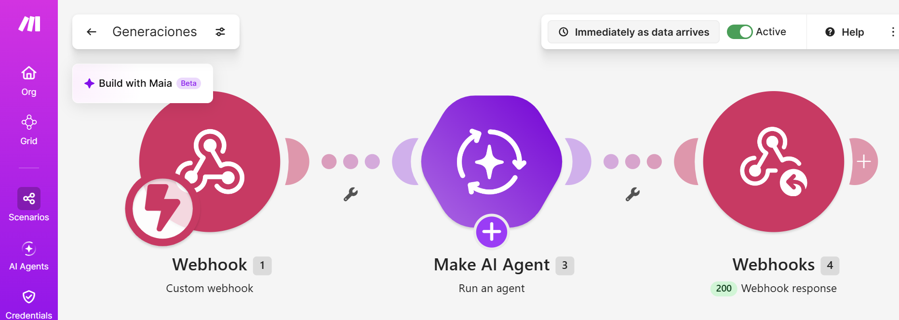
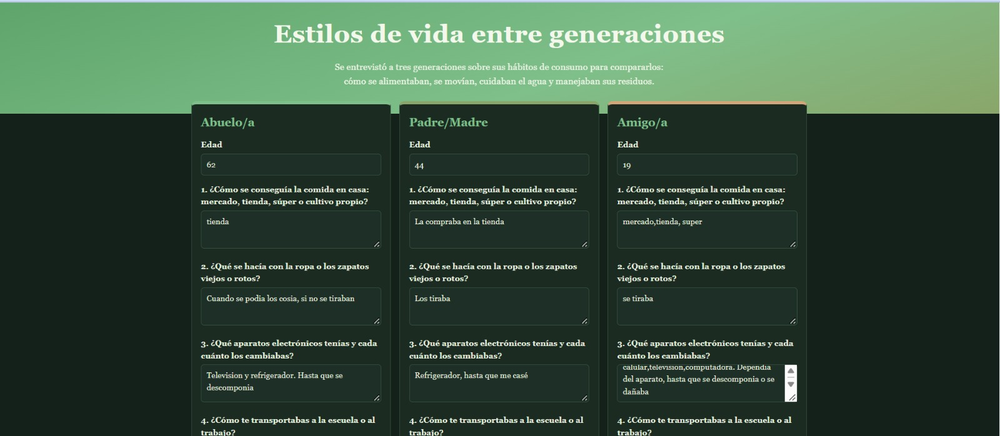
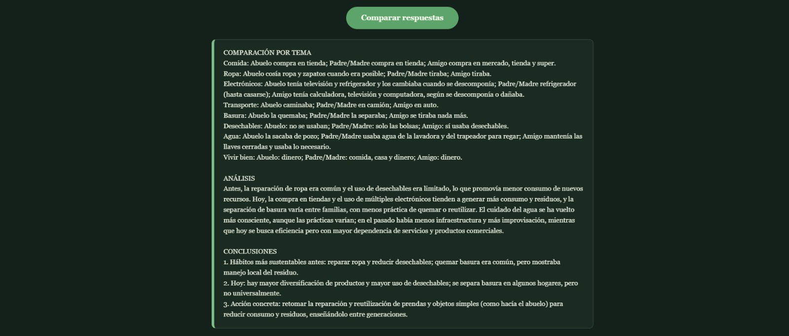

# Nombre del proyecto
Estilos de vida entre generaciones
## Descripción
“Estilos de vida entre generaciones” es una página web de un solo archivo HTML, con CSS y JavaScript incluidos, en la que se capturan las respuestas de tres personas a las mismas 8 preguntas sobre sus hábitos de consumo: cómo se conseguía la comida, qué se hacía con la ropa y los zapatos viejos, qué aparatos electrónicos se tenían y cada cuánto se cambiaban, cómo se transportaban, qué se hacía con la basura, si usaban bolsas, botellas o envases desechables, cómo se cuidaba el agua y qué consideran necesario para vivir bien. Cada una de las tres secciones (Abuelo/a, Padre/Madre y Amigo/a) tiene un campo de edad y un área de texto por pregunta. Antes de enviar, la página verifica que todos los campos estén llenos y, si falta alguno, muestra un aviso.
## Objetivos de aprendizaje
Que el alumno distinga los estilos de vida y de consumo de tres generaciones de su entorno, construya
sin programar una página web conectada a Make e IA para comparar sus respuestas, y formule
conclusiones propias sobre la sustentabilidad de esos hábitos.

## Material utilizado
Enumera todos los componentes usados:
• Computadora con navegador.
• Cuenta de Make del curso (plan Pro). La IA usa la conexión Make&#39;s AI Provider; no se necesita
API key.
• Cuenta en una IA generativa gratuita para generar la página.
• Cuenta de GitHub con su repositorio de prácticas.
• Tres personas para entrevistar: un abuelo o abuela, un padre o madre y un amigo o amiga de su
edad.
   
  
## Código
[Generaciones.blueprint.json](<Codigo/Generaciones.blueprint.json>)

[Index.html](<Codigo/index.html>)

Mi pagina ya publicada:
[Ver pagina](https://americac-dev.github.io/Class/Generaciones/Codigo/index.html)
## Imagenes
Foto del diagrama Make

Foto pagina

[Actividad 1](Imagenes/Actividad_1.pdf)

## Resultados
Incluye:
[Resultados](Resultados/Resultado_Estilo_de_vida_entre_generaciones.pdf)

## Video del funcionamiento
[Readme](Video/readme.txt)

[Ver video en YouTube](https://youtu.be/WVaZjYZHMxU)

## Conclusiones
La práctica cumple su objetivo: se entrevistó a tres generaciones, se construyó una página web conectada a Make y a un agente de IA que compara sus respuestas, y se formularon conclusiones propias sobre la sustentabilidad de sus hábitos. Se identificó que los hábitos más sustentables eran los de las generaciones anteriores, pero por necesidad, y que el consumo actual es más rápido y desechable por la publicidad, la tecnología, el ingreso y el crecimiento de la ciudad. También quedó claro que la IA es una herramienta útil para comparar y ordenar la información, pero no sustituye el criterio propio ni el contexto local, y que recuperar hábitos como reparar, reutilizar y cuidar el agua es una forma concreta de aplicar los principios de la Carta de la Tierra y la Agenda 21.

