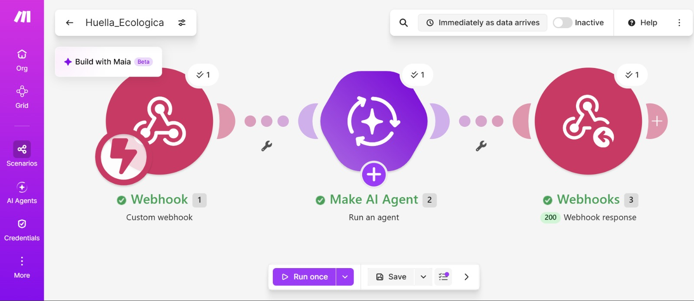
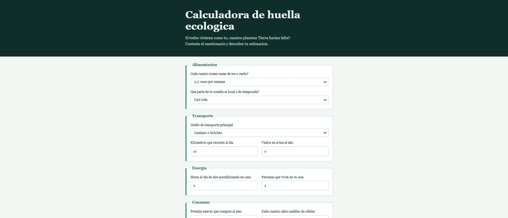

# Nombre del proyecto
Calculadora de huella ecológica

## Descripción

## Objetivos de aprendizaje

## Material utilizado
Enumera todos los componentes usados:
• Computadora con navegador.
• Cuenta de Make del curso. La IA usa la conexión Make&#39;s AI Provider; no se necesita API
key.
• Repositorio de GitHub para publicar la página.
• Calculadora oficial: https://www.footprintcalculator.org (permite elegir idioma español).
   
  
## Código
[Huella_Ecologica.blueprint.json](<Codigo/Huella_Ecologica.blueprint.json>)

[index..html](<Codigo/index..html>)

Mi pagina ya publicada:
[Ver pagina](https://americac-dev.github.io/Class/Codigo/index..html/)

## Imagenes
Foto del diagrama Make

Foto Index

[Investigacion](Imagenes/Actividad1_Investigación_huella_ecológica.pdf)

## Resultados
Incluye:
[Resultados](Resultados/.pdf)

## Video del funcionamiento
[Readme](Video/readme.txt)

[Ver video en YouTube](https://youtu.be/D_w5kpbnsDI)

## Conclusiones

