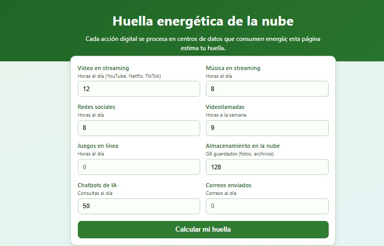
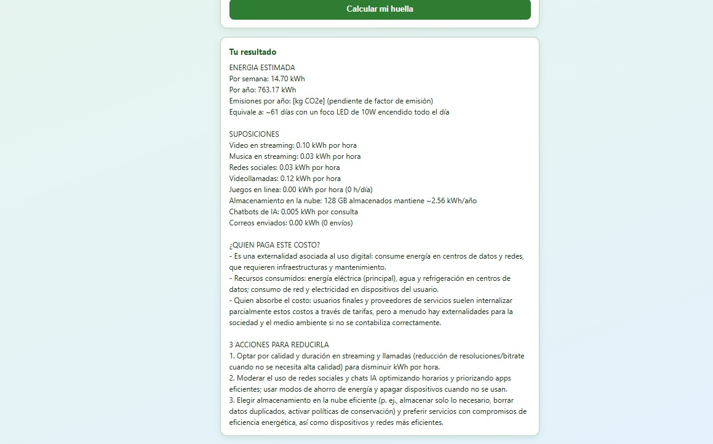

# Nombre del proyecto
Huella energética de la nube

## Descripción
“Huella energética de la nube” es un sistema que estima cuánta energía y cuántas emisiones genera el uso digital de una persona. La página web, generada con IA y publicada con GitHub Pages, tiene ocho campos numéricos (video, música, redes sociales, videollamadas, juegos en línea, GB guardados en la nube, consultas a chatbots de IA y correos enviados) y un botón, Calcular mi huella.

## Objetivos de aprendizaje
CReconocer el consumo de energía de los servicios digitales como un costo externalizado, estimar la huella energética de mi uso digital semanal con apoyo de una inteligencia artificial, y evaluar de forma crítica las suposiciones de esa estimación comparándolas con fuentes confiables.

## Material utilizado
Enumera todos los componentes usados:
Computadora con navegador y celular para revisar el tiempo de pantalla.
• Cuenta de Make del curso. La IA usa la conexión Make&#39;s AI Provider; no se necesita API
key.
• Repositorio de GitHub para publicar la página.
   
  
## Código
[Huella_Nube.blueprint.json](<Codigo/Huella_Nube.blueprint.json>)

[index,.html](<Codigo/index,.html>)

Mi pagina ya publicada:
[Ver pagina](https://americac-dev.github.io/Class/HuellaN/Codigo/index,.html)

## Imagenes
Foto del diagrama Make

Foto Index

## Resultados
Incluye:
[Resultados](Resultados/Resultado_Huella_Energetica_de_la_Nube.pdf)

## Video del funcionamiento
[Readme](Video/readme.txt)

[Ver video en YouTube](https://youtu.be/vj1HwDpnfFc)

## Conclusiones
La práctica cumple su objetivo: se construyó una página web conectada con Make y un Make AI Agent que estima la huella energética del uso digital de una persona y explica quién paga ese costo. La actividad que más consumió fue Video en streaming. Los resultados son aproximados porque dependen de suposiciones como el consumo por hora de video y el factor de emisión de 0.444 kg CO₂e por kWh, y al compararlas con la IEA y la Carbon Trust vi que las fuentes varían bastante. Aun así, la práctica muestra que el uso de la nube es un costo externalizado y que se puede reducir con cambios de hábitos y con medidas como impuestos, energía renovable y precios que reflejen el costo ambiental.
