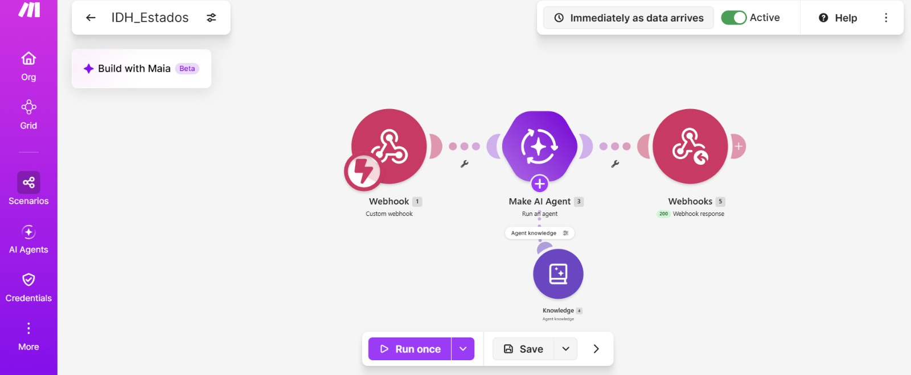
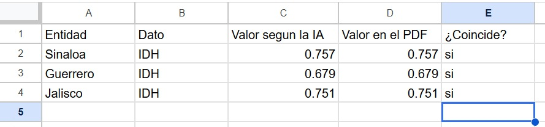
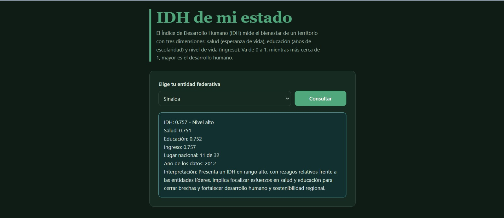

# Nombre del proyecto
Página web IDH de mi estado
## Descripción
“IDH de mi estado” es una página web de un solo archivo HTML con una lista desplegable de las 32 entidades federativas y un botón “Consultar”. Al presionarlo, envía la entidad elegida con el método POST, como formulario con un solo campo llamado “entidad”, a un webhook de Make. En el escenario, un Make AI Agent que tiene como conocimiento el archivo IDH_entidades.pdf responde en texto plano con el IDH, los índices de salud, educación e ingreso, el lugar nacional, el año de los datos y una breve interpretación; después, un módulo Webhook Response devuelve ese texto a la página, que lo muestra en un recuadro.
Los datos provienen del informe del PNUD “Índice de Desarrollo Humano para las entidades federativas, México 2015” y corresponden al año 2012.

## Objetivos de aprendizaje
Interpretar el Índice de Desarrollo Humano (IDH) y sus componentes para las entidades de México, construir sin programar una página web conectada a Make y a un agente de IA que consulte datos oficiales del PNUD, y verificar que la información que genera la IA sea fiel a la fuente.

## Material utilizado
Enumera todos los componentes usados:
1. Make
2. Word
   
  
## Código
[IDH_Estados.blueprint.json](<Codigo/IDH_Estados.blueprint.json>)

## Imagenes
Foto del diagrama Make

Foto Google sheets

[Desarrollo humano, IDH, rezago social y desarrollo urbano y rural.docx](Imagenes/Desarrollo humano, IDH, rezago social y desarrollo urbano y rural.docx)

## Resultados
Incluye:
[Resultados](Resultados/Resultado_IDH_de_mi_estado.pdf)

## Video del funcionamiento
[Readme](Video/readme.txt)

[Ver video en YouTube]([https://youtu.be/dlbZfRPe83c](https://youtu.be/2337rGU2ZvI))

## Conclusiones
La práctica cumple su objetivo: se construyó una página que consulta el IDH de cada entidad mediante Make y un agente de IA, y se interpretó el caso de Sinaloa, con un IDH de 0.757 (lugar 11 de 32), fortaleza en educación y rezago en salud. Se identificó que las principales limitaciones son que los datos son de 2012, que el promedio estatal oculta diferencias entre zonas urbanas y rurales y que la IA puede equivocarse, lo que muestra que la tecnología facilita el acceso a la información, pero no sustituye la verificación ni la responsabilidad de quien toma decisiones.
