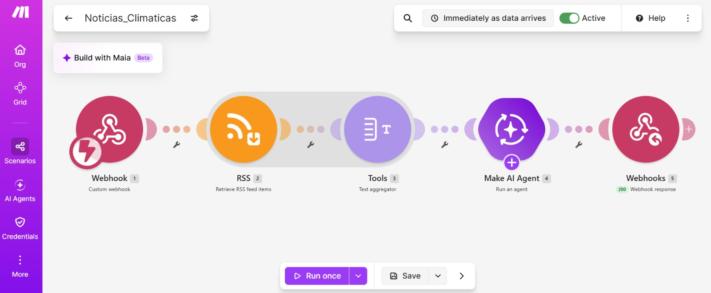
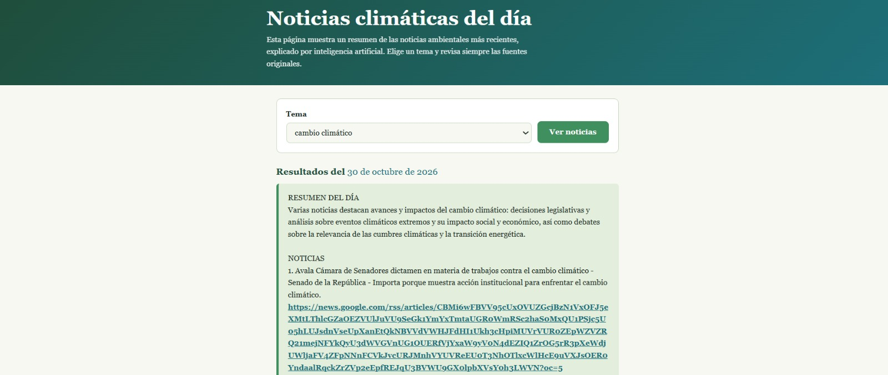

# Nombre del proyecto
Noticias climáticas del día

## Descripción
“Noticias climáticas del día” es una página web de un solo archivo HTML, con CSS y JavaScript incluidos y sin librerías externas. Tiene un título, una breve explicación, una lista desplegable “Tema” con 6 opciones y un botón “Ver noticias”. Al presionarlo, la página muestra el mensaje “Buscando y resumiendo noticias...”, desactiva el botón y envía el tema elegido a Make. La respuesta se muestra en un recuadro debajo del botón, con la fecha de hoy, respetando los saltos de línea y con los enlaces a las fuentes en forma clicable. Si ocurre un error, la página avisa que no se pudieron obtener las noticias y pide intentar de nuevo.

## Objetivos de aprendizaje
Que el alumno construya sin programar una herramienta de difusión ambiental que obtenga noticias
recientes mediante RSS, las resuma con IA y las muestre en una página web, verificando que los
resúmenes sean fieles a sus fuentes.

## Material utilizado
Enumera todos los componentes usados:
• Computadora con navegador.
• Cuenta de Make del curso (plan Pro). La IA usa la conexión Make&#39;s AI Provider; no se necesita
API key.
• Cuenta en una IA generativa gratuita para generar la página.
• Cuenta de GitHub con su repositorio de prácticas.
   
## Código
[Noticias_Climaticas.blueprint.json](<Codigo/Noticias_Climaticas.blueprint.json>)

[Index.html](<Codigo/index.html>)

Mi pagina ya publicada:
[Ver pagina](https://americac-dev.github.io/Class/Noticias%20Climaticas/Codigo/index.html)
## Imagenes
Foto del diagrama Make

Foto pagina

## Resultados
Incluye:
[Resultados](Resultados/Resultado_Noticias_climaticas_del_dia.pdf)

## Video del funcionamiento
[Readme](Video/readme.txt)

[Ver video en YouTube]()

## Conclusiones
La práctica cumple su objetivo: se construyó, sin programar, una página web conectada a Make que obtiene noticias ambientales recientes mediante RSS, las resume con inteligencia artificial y muestra el resultado con los enlaces a sus fuentes. Se comprobó que la automatización permite difundir información ambiental de forma rápida y accesible, pero que la IA no sustituye la verificación: sus resúmenes se basan en titulares y deben revisarse con las fuentes. También quedó claro que los temas locales tienen menos presencia en las noticias, por lo que herramientas como esta pueden ayudar a que la comunidad conozca mejor su propio entorno.
