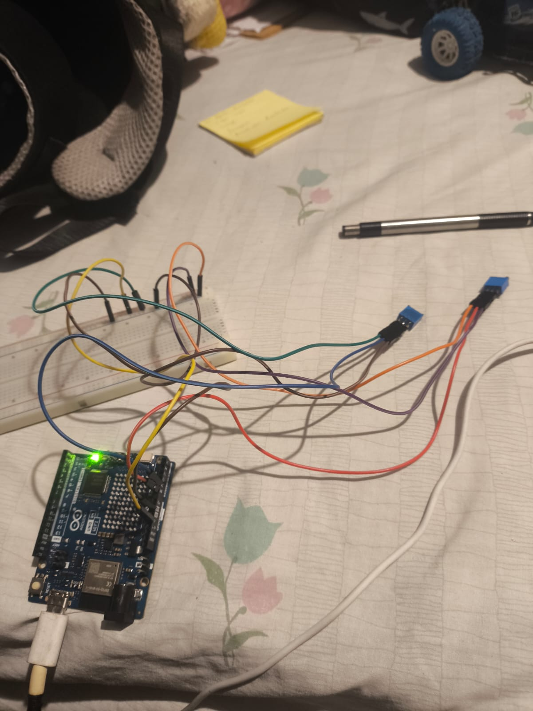
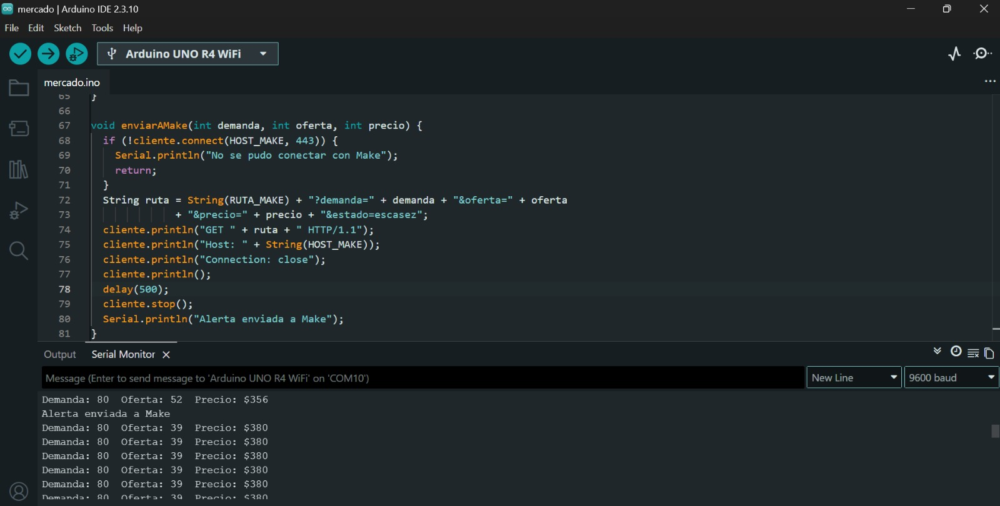

# Nombre del proyecto
Simulador de oferta y demanda

## Descripción

## Objetivos de aprendizaje
Que el alumno explique cómo la oferta y la demanda fijan los precios, relacione la escasez de un
recurso natural con su precio, y construya un sistema IoT que convierta un fenómeno económico en
datos y alertas automáticas.

## Material utilizado
Enumera todos los componentes usados:
• Arduino UNO R4 WiFi con su cable USB-C.
• 2 potenciómetros de 10 kΩ, protoboard y cables jumper.
• Computadora con Arduino IDE y las librerías ArduinoGraphics y Arduino_LED_Matrix (la
segunda viene con el paquete de la placa UNO R4).
• Red WiFi de 2.4 GHz con usuario y contraseña (no funciona con redes que piden iniciar
sesión en una página).
• Cuenta de Make del curso y Telegram en el celular.
   
  
## Código
[Mercado_Equipo.blueprint.json](<Codigo/Mercado_Equipo.blueprint.json>)

## Imagenes
Foto del diagrama Make

Foto Telegram

Foto armado

Foto Arduino IDE

[Investigacion](Imagenes/Act1_oferta_demanda.docx)

## Resultados
Incluye:
[Resultados](Resultados/)

## Video del funcionamiento
[Readme](Video/readme.txt)

[Ver video en YouTube](https://youtube.com/shorts/cO8YILxc75o)

## Conclusiones
