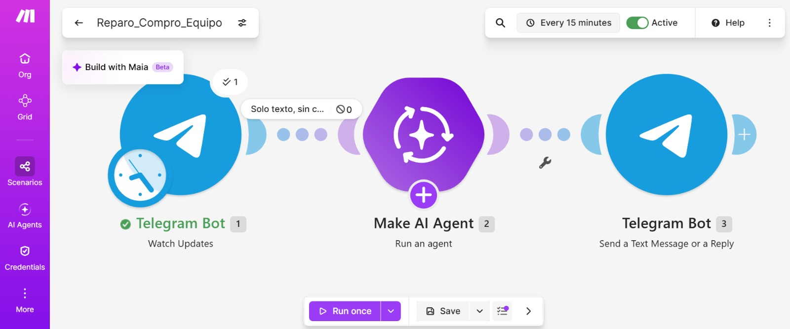
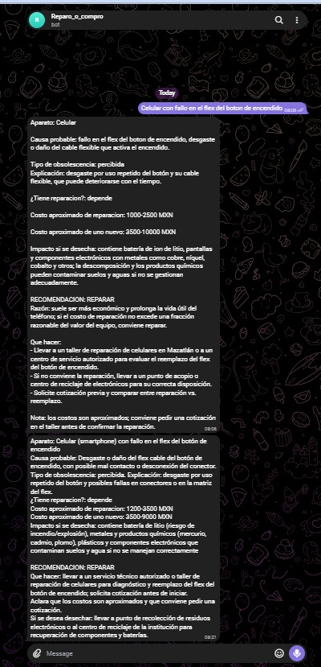

# Nombre del proyecto
Bot ¿Reparo o compro?

## Descripción
“¿Reparo o compro?” es un bot de Telegram conectado a un escenario de Make que recibe la descripción de un aparato con falla, por ejemplo “laptop de 4 años que se calienta y se apaga”, y responde con una recomendación de reparar, reemplazar o donar o reciclar. El flujo tiene tres módulos: Telegram Bot (Watch Updates), que recibe el mensaje; Make AI Agent, que usa la conexión Make’s AI Provider y analiza la falla; y Telegram Bot (Send a Text Message or a Reply), que devuelve la respuesta al mismo chat.
Los datos provienen del informe del PNUD “Índice de Desarrollo Humano para las entidades federativas, México 2015” y corresponden al año 2012.

## Objetivos de aprendizaje
Distinguir la obsolescencia planificada de la percibida en casos reales, valorar la reparación como alternativa de consumo y verificar con información local las recomendaciones de una inteligencia artificial, construyendo sin programar un bot de Telegram en Make que recomienda si conviene reparar o reemplazar un aparato con falla.

## Material utilizado
Enumera todos los componentes usados:
• Celular con Telegram y computadora con navegador.
• Cuenta de Make del curso. La IA usa la conexión Make&#39;s AI Provider; no se necesita API
key.
• Al menos 6 aparatos con falla (propios, de familiares o vecinos) para probar el bot.
• Haber realizado la práctica del chatbot de Gobernanza (BotFather, Watch Updates y
setWebhook).
   
  
## Código
[Reparo_Compro_Equipo.blueprint.json](<Codigo/Reparo_Compro_Equipo.blueprint.json>)

## Imagenes
Foto del diagrama Make

Foto Telegram

[Investigacion](Imagenes/Act1.pdf)

## Resultados
Incluye:
[Resultados](Resultados/Resultado_Reparo_Compro.pdf)

## Video del funcionamiento
[Readme](Video/readme.txt)

[Ver video en YouTube](https://youtu.be/D_w5kpbnsDI)

## Conclusiones
La práctica cumple su objetivo: se construyó un bot de Telegram en Make que, a partir de la descripción de una falla, recomienda reparar, reemplazar o reciclar, con costos aproximados y el impacto de desechar el aparato. Al compararlo con la cotización de un taller de Mazatlán se identificó que la IA sirve como un primer filtro para orientar la decisión, pero no sustituye la revisión de un técnico. También permitió reconocer casos de obsolescencia planificada y percibida y valorar la reparación como una alternativa que ahorra dinero y reduce residuos electrónicos.
